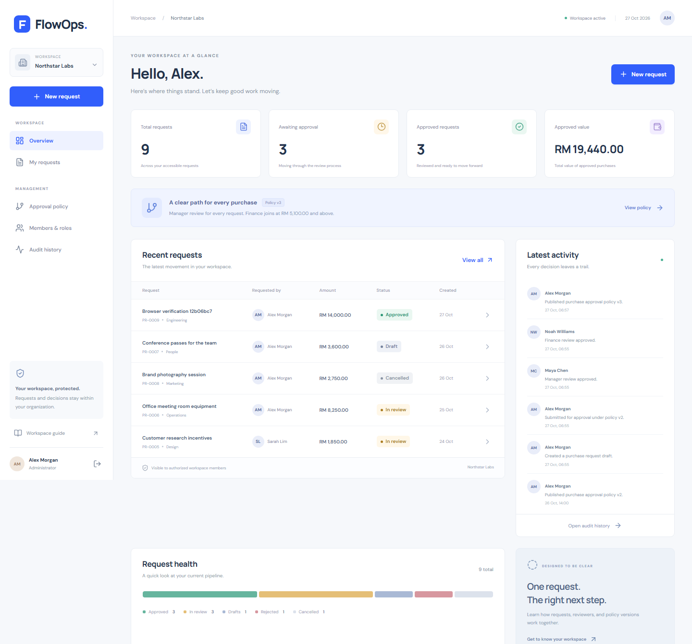

# FlowOps

A purchase approval engine built with React JavaScript, Laravel, and PostgreSQL.

[](https://github.com/fitrirusli/flowops/actions/workflows/ci.yml)

Employees save and submit purchase requests. The published policy selects manager review, followed by finance review when the amount reaches the configured threshold. Every request keeps its policy version and decision history.



## What works

- Session login and separate organization workspaces.
- Purchase drafts, submission, approval, rejection, cancellation, and linked new drafts.
- Approval inbox, request history, and organization audit history.
- A simple policy editor with immutable published versions.
- Server-side organization authorization, transaction-protected decisions, and idempotent commands.
- Responsive screens written in **JavaScript and JSX**, without TypeScript application code.

## Run locally

On the prepared development machine, open this directory in a terminal and run:

```sh
npm run dev
```

Open [the workspace](http://127.0.0.1:5173). Stop both application servers with Ctrl+C.

For a fresh checkout, follow [local development](docs/LOCAL_DEVELOPMENT.md), configure PostgreSQL, and run `npm run setup` first. Compatible PHP and PostgreSQL runtimes are required; they are not committed to Git.

## Demo accounts

Local synthetic data uses the password `FlowOpsDemo!2026`.

| Email | Role in Northstar Labs |
| --- | --- |
| alex@flowops.test | Administrator and requester |
| maya@flowops.test | Manager approver |
| noah@flowops.test | Finance approver |
| sarah@flowops.test | Requester |

Alex also has an auditor role in Cedar Works. The local sign-in page can fill demonstration credentials when demo mode is enabled. Demo mode must remain disabled for a real deployment.

## Verify

```sh
npm test
npm run test:e2e
```

The first command runs backend tests, JavaScript tests, independent PostgreSQL concurrency scenarios, and the frontend production build. Browser tests require running application servers and a Playwright Chromium installation. Tests use a dedicated `flowops_test` database.

## Read more

[Current release scope](docs/RELEASE_SCOPE.md) · [Implementation](docs/IMPLEMENTATION.md) · [API reference](docs/API_REFERENCE.md) · [Verification](docs/VERIFICATION.md) · [All documentation](docs/README.md)

FlowOps is the working name of this independently implemented portfolio project. The product category and name are also used by unrelated projects. Hosted deployment and license selection remain pending.
