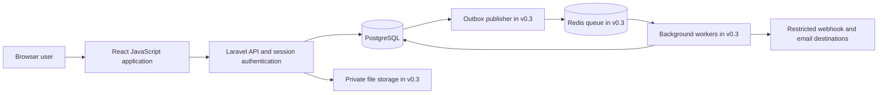

> Planning record from 27 October 2026. This is the earlier design exploration, not the current implementation status. See the [current project README](../README.md) and the shipped release documents.

# FlowOps architecture

Status: proposed architecture. Components shown below have not been deployed.

## System shape

FlowOps will use a React JavaScript single-page application and a Laravel REST API in one repository. The backend is a modular monolith: one deployable application with clear internal business modules and one primary PostgreSQL database.

The outbox publisher is an application process that reads committed database events. PostgreSQL does not push events directly to Redis in this design.

## Responsibilities

| Module | Owns |
| --- | --- |
| Identity | User identities, password handling, sessions, and authentication. |
| Organizations | Workspaces, membership, roles, and tenant context. |
| Forms | Allowed field definitions, answer validation, and rendering metadata. |
| Workflows | Draft configuration, publishing, version validation, and route resolution. |
| Requests | Drafts, submission snapshots, cancellation, and request visibility. |
| Approvals | Step activation, eligibility, decisions, reassignment, and concurrency rules. |
| Audit | Append-only business history exposed through authorized read paths. |
| Notifications | Later reminders and delivery records. |
| Integrations | Later endpoints, durable deliveries, attempts, and replay controls. |

Start with ordinary Laravel conventions and explicit services. Introduce a new abstraction when a real boundary or repeated requirement justifies it.

## Frontend architecture

- Use functional components and hooks in JavaScript and JSX.
- Organize screens and domain behavior by feature.
- Use TanStack Query for server-state fetching and invalidation.
- Keep ephemeral interface state in React hooks.
- Use React Hook Form for forms; match client checks to server rules.
- Centralize HTTP behavior, authentication handling, and API error interpretation.
- Include organization identity in query keys and clear relevant cached data on workspace changes or logout.

The browser helps the user complete actions. Laravel remains authoritative for permissions, validation, routing, and state transitions.

## Authentication and request context

Use Sanctum's first-party SPA session approach. Serve the UI and API under the same origin in production where practical. A local development proxy can present the same browser-facing origin while forwarding API and authentication paths.

Resolve organization context from the URL and verify active membership server-side on every request. Never trust an organization identifier supplied in request data without this verification.

See [API design](API_DESIGN.md) and [security](SECURITY_AND_PRIVACY.md).

## Database and transaction boundary

PostgreSQL stores identities, organization membership, workflow versions, requests, steps, decisions, and audit records. Tenant-owned entities carry `organization_id`.

Core request mutations lock the request row first and then relevant step rows in a consistent order. The state update, decision record, audit record, and later outbox event commit in one transaction. Concurrent operations re-check the state after obtaining locks.

Use exact money values and database constraints. A route is resolved from a validated published policy and captured with the submission so execution does not depend on a later policy edit.

## Version boundary

Mutable workflow drafts are separate from immutable published versions. A published version includes form schema, routing rules, and assignment templates. Requests bind to the version selected during submission and retain a validated answer snapshot.

Approver reassignment changes an individual runtime step through an audited operation. It does not rewrite the published assignment template.

## Background reliability

v0.1 is fully usable without external delivery promises. The request details and inbox are authoritative. From v0.3, a transactionally written outbox connects committed business actions to background processing.

The publisher may enqueue an event more than once if it fails between publishing and recording progress. Workers therefore deduplicate by stable event and effect identifiers. PostgreSQL is the recovery source if Redis loses queued messages.

Outbound webhooks have at-least-once delivery semantics. A remote receiver can apply an effect and lose the response, so FlowOps cannot promise exactly-once external effects. See [workflow engine](WORKFLOW_ENGINE.md).

## Deployment direction

The planned portfolio deployment consists of static frontend assets, one Laravel application, PostgreSQL, private object storage when attachments exist, and later Redis, workers, and a scheduler. Use TLS and a private network for internal data services.

Begin with one region and one application instance. Replication, horizontal scaling, and separate services require demonstrated operational need.

## Trade-offs

| Choice | Benefit | Cost or constraint |
| --- | --- | --- |
| JavaScript frontend | Familiar development model for the owner | Runtime validation and tests must catch data-shape mistakes. |
| Modular monolith | Simple deployment and clear transactions | Module boundaries require discipline. |
| Shared tenant database | Manageable operations and useful tenancy exercise | Every query and background task must enforce tenant boundaries. |
| Immutable configuration versions | Stable historical meaning | More storage and explicit handling of stale drafts. |
| Transactional outbox | Recovery from publish failures | More records, workers, deduplication, and operational work. |

## Sources

The proposed session design follows [Laravel Sanctum SPA authentication](https://laravel.com/docs/13.x/sanctum#spa-authentication). The frontend will use Vite's [JavaScript React template](https://vite.dev/guide/). These references were checked on 27 October 2026; versions will be reviewed again before scaffolding.
