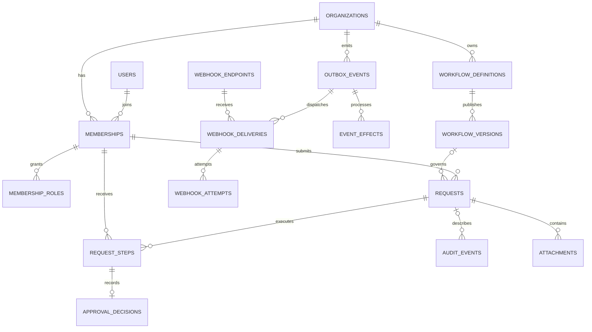

> Planning record from 27 October 2026. This is the earlier design exploration, not the current implementation status. See the [current project README](../README.md) and the shipped release documents.

# FlowOps data model

Status: conceptual design. No migrations or database objects exist.

## Modeling rules

- Use opaque application identifiers and UTC timestamps.
- Every tenant-owned record carries `organization_id`.
- Enforce tenant ownership in application policies and composite database relationships where applicable.
- Store money as integer minor units with a currency code. The initial product supports MYR only.
- Store validated form and policy configuration in JSONB snapshots. Keep relationships, statuses, and query-critical attributes relational.
- Use explicit constraints, not identifiers alone, to protect invariants.

## Core entities

| Entity | Important attributes | Purpose |
| --- | --- | --- |
| users | id, display_name, email, password_hash, account_status | Global sign-in identity; email and credentials are never public profile data. |
| organizations | id, name, slug, status | Workspace boundary. |
| memberships | id, organization_id, user_id, status | A user's membership in one organization. |
| membership_roles | organization_id, membership_id, role | Additive requester, approver, administrator, and auditor roles. |
| workflow_definitions | id, organization_id, name, status, draft_form_schema, draft_routing_schema, draft_revision, published_version_id | Mutable authoring state and pointer to the current published version. |
| workflow_versions | id, organization_id, workflow_definition_id, version_number, form_schema, routing_schema, published_by_membership_id, published_at | Immutable published configuration, including assignment templates. |
| requests | id, organization_id, requester_membership_id, workflow_definition_id, workflow_version_id, source_request_id, status, title, amount_minor, currency, draft_answers, submitted_answers, resolved_route, revision, submitted_at, completed_at | Draft data followed by a locked submission snapshot and lifecycle state. |
| request_steps | id, organization_id, request_id, position, step_key, label, assignee_membership_id, status, blocked_reason, activated_at, due_at, completed_at | Concrete runtime assignments and execution state. |
| approval_decisions | id, organization_id, request_id, request_step_id, actor_membership_id, decision, reason, decided_at | One immutable approve or reject decision for a completed approval step. |
| audit_events | id, organization_id, actor_membership_id, request_id, event_type, subject_type, subject_id, redacted_metadata, occurred_at | Append-only business and administrative history. |
| idempotency_records | id, organization_id, actor_membership_id, action_scope, key_hash, payload_hash, resource_id, response_status, expires_at | Duplicate-safe results for protected actions. |

Framework session and password-related tables will be selected during scaffolding. They are not a substitute for organization membership checks.

## Reliability release entities

| Entity | Important attributes | Purpose |
| --- | --- | --- |
| outbox_events | id, organization_id, aggregate_id, event_type, payload, occurred_at, publish_state, next_attempt_at | Durable events committed with business transitions. |
| event_effects | id, organization_id, outbox_event_id, effect_key, state, lease_until, next_attempt_at, completed_at | Durable deduplication and recovery for each internal effect. |
| notifications | id, organization_id, recipient_membership_id, event_effect_id, kind, read_at | Internal notification records with duplicate protection. |
| reminder_records | id, organization_id, request_step_id, reminder_window, outbox_event_id | One reminder event per configured window. |
| webhook_endpoints | id, organization_id, url, encrypted_secret, status, event_subscriptions | Approved outbound destinations and signing credentials. |
| webhook_deliveries | id, organization_id, outbox_event_id, webhook_endpoint_id, state, next_attempt_at, lease_until, attempt_count | One logical delivery per endpoint and event. |
| webhook_attempts | id, organization_id, webhook_delivery_id, attempt_number, outcome, response_status, duration_ms, attempted_at | Redacted attempt-level results. |
| attachments | id, organization_id, request_id, uploader_membership_id, private_storage_key, original_name, mime_type, size_bytes, scan_status | Private file metadata and access checks. |

The event payload must contain only what authorized consumers need. Secrets, raw credentials, and complete request forms must not be copied into delivery logs.

## Relationship overview

The diagram summarizes business relationships. It omits some tenant and actor references for readability; all tenant-owned entities still require organization constraints.

## Required uniqueness and checks

- Membership is unique by organization and user.
- A membership-role pair is unique and uses an allowed role value.
- A version number is unique within its organization and workflow definition.
- A definition's published-version pointer must reference a version belonging to that definition and organization.
- Each request step position is unique within its request.
- A partial unique constraint permits at most one pending step per request in the sequential engine.
- A decision is unique by request step. Only approve and reject are allowed decision values.
- An idempotency record is unique by organization, actor, action scope, and key hash.
- An internal effect key is unique for its event and organization.
- A webhook delivery is unique by organization, endpoint, and event.
- An attempt number is unique within a webhook delivery.
- A reminder window is unique within a request step.
- Amounts are nonnegative bounded integers; timestamps and terminal-state requirements are checked where practical.

Database constraints complement transaction-level checks. They do not replace permissions or membership validation.

## Tenant references

Tenant-owned tables expose a unique `(organization_id, id)` pair for composite references. For example, a request step's organization and request ID must reference a request in the same organization. Its assignee membership must belong to that organization as well.

Use the same pattern for version references, decisions, attachments, webhook records, and source-request links. No cross-organization reference should be accepted merely because a global ID exists.

## Request snapshots

Before submission, a request stores editable draft answers. On submission, the server validates those answers against the current expected published version, stores submitted answers and the resolved route, and binds `workflow_version_id`.

The request's money and currency attributes are derived from the validated reserved amount field and must agree with the snapshot. Post-submission endpoints cannot edit the snapshot or reference amount.

Copying a rejected or cancelled request creates a new draft with a source link. It does not copy decisions or create a second execution of the original request. The draft is revalidated against the current published version when submitted.

## Query and index direction

Start with indexes supporting organization plus status and creation time, requester plus status, assignee plus step status, audit subject plus time, and due work plus next-attempt time. Review actual query plans before adding speculative indexes.

Use cursor pagination or bounded page sizes for growing histories. Never fetch every organization's records and filter them in the browser.

## Lifecycle and deletion

Deactivate memberships rather than deleting identities referenced by history. Archive published workflow definitions. Preserve submitted requests, steps, and decisions through ordinary application operations.

Retention, personal-data redaction, and organization removal need a documented administrative procedure before use with real organizational data. Append-only application behavior does not make records tamper-proof against a privileged database administrator.
