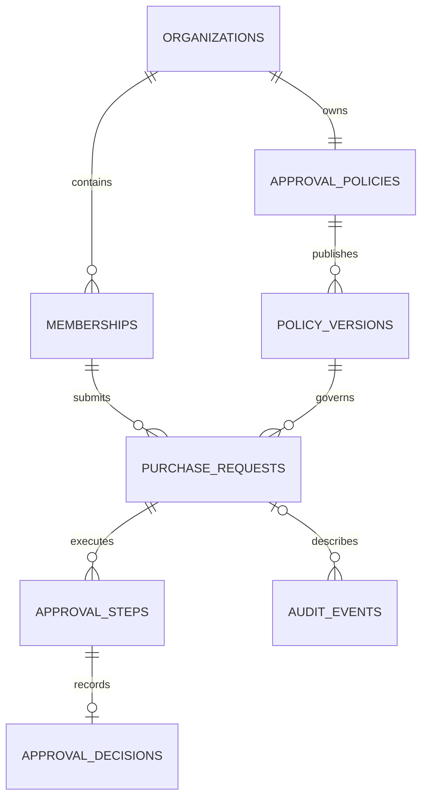

# First release implementation

## Product

A fixed purchase form feeds a versioned approval policy. Every request requires manager approval; finance approval follows when its MYR amount is at or above the published threshold. The requester cannot be any required approver.

The shipped release contains no dynamic form builder, attachments, background deliveries, billing, or AI. FlowOps remains a working name already used elsewhere.

## Runtime and interface

The web application uses React, JavaScript/JSX, Vite, React Router, TanStack Query, and authored CSS. The backend uses Laravel 13, Sanctum, and PostgreSQL. Package lockfiles record exact versions. Google Fonts is optional presentation enhancement with system-font fallbacks.

The interface has sign in, overview, owned or accessible requests, approval inbox, draft editor, request details, policy settings, membership directory, audit history, and a workspace guide. Loading, empty, error, conflict, and successful-action states are included.

Timestamps are stored in UTC and displayed in Asia/Singapore for this release. Currency values are shown in MYR.

## Internal responsibilities

| Location | Responsibility |
| --- | --- |
| `apps/api/app/Services/TenantAccess.php` | Active membership, role checks, and visible request queries. |
| `apps/api/app/Services/ApprovalEngine.php` | Drafts, submission, decisions, cancellation, publication, audit, and command deduplication. |
| `apps/api/app/Services/RequestPresenter.php` | Safe response fields, histories, and available actions for the current viewer. |
| `apps/api/app/Http/Controllers/` | HTTP validation and delegation to services. |
| `apps/web/src/features/` | User journeys grouped by feature. |
| `apps/web/src/app/SessionContext.jsx` | Session identity and organization switching without retaining the old workspace cache. |

## Authentication and tenancy

Browser sessions use HttpOnly session cookies with CSRF-protected mutations. The local Vite proxy forwards authentication and API paths to Laravel. Session state is encrypted in the database in the prepared configuration. Authentication tokens are not placed in browser local storage; only the selected organization identifier is remembered there.

Every tenant API path resolves an active membership for the session user. Request visibility is limited to owned records, assigned submitted records, or submitted organization records for administrators/auditors. Other members cannot read a requester's draft. An administrator role alone does not permit an approval decision.

Tenant-owned relationships have composite database foreign keys. An assignment, policy reference, decision, or source link cannot point to another organization's membership or request. Opaque UUIDs supplement, rather than replace, authorization.

The membership directory is read-only. Public registration, account recovery, role editing, and invitations are not implemented.

## Data model

Core tables are users, organizations, memberships, approval_policies, policy_versions, purchase_requests, approval_steps, approval_decisions, audit_events, and command_results. Framework tables support sessions, cache, and unused queue defaults.

Membership roles are stored as an application-controlled JSON array. An organization has one purchase approval policy. Published versions snapshot the threshold and named reviewer memberships. Requests bind to a policy version and preserve their submitted fields. Money is stored as integer minor units; MYR 5,000.00 is 500000.

## Policy publishing and request snapshots

Publishing locks the organization's policy and checks its expected revision. The next immutable version is created and the current-version pointer is advanced in one transaction. The Eloquent model rejects updates and deletes of published policy versions.

Submission acquires the same policy lock before the request lock. It checks the version explicitly reviewed by the client, validates required reviewer eligibility, creates the concrete route, and binds the request to that version atomically. A stale reviewed version receives HTTP 409. No existing submission is rewritten.

The form is fixed, so submitted title, amount, department, and justification remain in protected relational fields. The published version and concrete approval steps capture the applicable policy and route; a general JSON form snapshot is unnecessary for this scope.

## Lifecycle and concurrency

Request states are draft, pending, approved, rejected, and cancelled. Steps are waiting, pending, approved, rejected, or cancelled. A partial unique PostgreSQL index permits at most one pending step per request. A unique decision reference permits at most one decision per step.

Every approve, reject, and cancel command locks the request before checking its revision and state. Approval additionally locks the target step and verifies its current assignment. Rejection or cancellation closes outstanding work. A winning terminal decision causes a competing action to return a conflict.

For an intermediate approval followed by cancellation, serialization can validly allow both commands only if the second command uses the updated revision; a stale simultaneous command conflicts. The first terminal state cannot be reopened.

Rejected and cancelled requests can be copied into a new owned draft with a source reference. Their original history remains unchanged.

## Idempotency

Protected commands require an `Idempotency-Key`. A PostgreSQL advisory transaction lock serializes the key within organization, actor, and action scope, including reuse across different target rows. A canonical payload hash detects changed input. The business result and response snapshot are stored in the same transaction.

An exact replay returns the recorded response and does not repeat the transition. A changed payload using the same key returns 409. Database state constraints still protect the lifecycle independently of command keys.

There are no external deliveries in this release, so no exactly-once or outbox claims are made.

## Audit and operational limits

Business events include the actor, time, request link, and appropriate decision reason. Diagnostic responses use correlation IDs and hide stack traces. Diagnostic logs do not deliberately copy credentials or full request bodies.

Read-only application history is not tamper-proof against privileged database access. Published-version immutability is enforced by the application's model and write paths; it is not a database protection against an administrator issuing raw SQL.

The prepared database role is a local development cluster owner. A real deployment needs an appropriately restricted role and an operational security review. No production load, uptime, recovery-time, or compliance claim is made.

## Current scope authority

The [release scope](RELEASE_SCOPE.md) supersedes broader earlier planning documents. The project is suitable for local demonstration and inspection of the verified behaviors, with publication and production operation requiring their own preparation.
