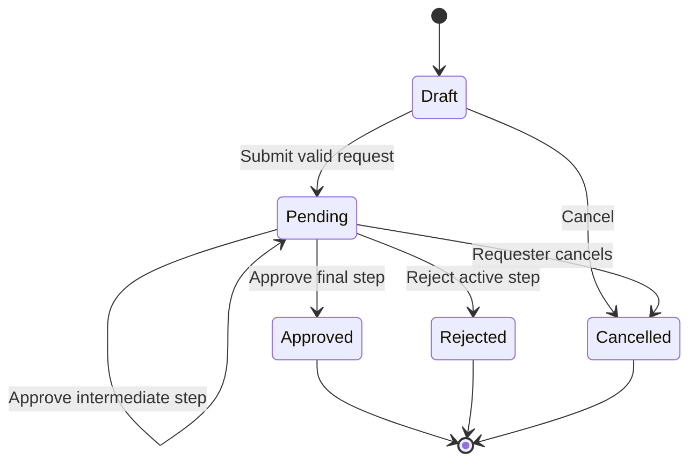

> Planning record from 27 October 2026. This is the earlier design exploration, not the current implementation status. See the [current project README](../README.md) and the shipped release documents.

# FlowOps workflow engine design

Status: proposed behavioral specification.

## Core concepts

A workflow definition is the administrator-managed identity of a business process. It has mutable draft configuration and zero or more immutable published versions. A submitted request references one published version and has concrete runtime approval steps.

Configuration describes a bounded approval process. It cannot contain JavaScript, PHP, SQL, arbitrary expressions, or executable templates.

## Initial release

v0.1 uses a fixed purchase form and a fixed sequence: manager approval followed by finance approval. Named active members are configured as approvers. The release establishes the lifecycle, isolation, and transaction rules before adding an administrator configuration editor.

## Configurable release

v0.2 supports a start, a bounded condition, ordered approval steps, and an end. The configuration editor exposes structured fields and route controls rather than a free-form programming language.

The initial conditional policy compares the submitted amount in MYR minor units with a configured threshold:

- Below MYR 5,000: manager approval.
- At or above MYR 5,000: manager approval, then finance approval.

Every supported input must match exactly one route. Both routes require at least one approval. The engine evaluates the route once during submission from validated, immutable answers.

## Form schema

Initial configurable field types are short text, long text, integer, amount, date, single select, and checkbox. Allowed validation includes requiredness, length limits, numeric bounds, and allowed options.

Field keys are stable within a version and distinct from editable labels. System fields such as the reference amount have reserved keys and types. Submitted answers cannot supply organization, actor, status, or assignment fields.

Conditional field visibility is limited to equality checks against supported field values. Hidden field answers are removed before authoritative validation and snapshot creation. The editor prevents visibility cycles and references to missing fields. Unsupported combinations fail validation explicitly.

## Publishing rules

Publishing requires:

1. A valid form schema and a permitted routing configuration.
2. Exactly one reachable start and end for each supported route.
3. No cycles, disconnected steps, or ambiguous conditions.
4. At least one approval step on every route.
5. Named, active members with the approver role for every assignment template.
6. A sample preview that includes threshold boundary cases.

The publisher locks the workflow definition, assigns the next version number, stores an immutable snapshot, and updates the published-version pointer atomically. A competing edit or publish operation returns a version conflict rather than overwriting another change.

Published content is not edited or deleted through application operations. Archiving a definition prevents new submissions while retaining active requests and their history.

## Draft and submission rules

A draft belongs to one requester and organization and points to a workflow definition. The browser loads the current published version and includes its version identifier when submitting.

Submission locks the definition and request in the established order, verifies the expected published version, checks membership, validates answers, resolves a route, and validates all assignments. It then stores the published version reference, answer snapshot, route snapshot, and concrete steps.

The initial step becomes pending and the request becomes pending in the same transaction. If an approver is the requester, has lost membership, or is otherwise ineligible, submission is rejected without creating partial tasks. The requester or administrator must correct the assignment through permitted configuration.

An idempotency key belongs to an organization, actor, action, and canonical request payload hash. The same key and payload return the existing result; a changed payload with the same key returns a conflict.

## Request state machine

Persisted statuses use `draft`, `pending`, `approved`, `rejected`, and `cancelled`. Terminal requests cannot be edited or reopened. A new draft may reference a rejected or cancelled request as its source, while preserving the old record.

## Step state and decisions

Runtime steps use `waiting`, `pending`, `approved`, `rejected`, and `cancelled`. Sequential execution permits one pending step per request. Completing one step activates the next waiting step; completing the last approves the request.

Only the current assigned active approver may decide a pending step. A rejection requires a reason. Cancellation or rejection cancels remaining waiting and pending steps so no actionable tasks remain.

An administrator may reassign a pending step to another eligible member with a reason. A missing or inactive assignee places a visible blocked reason on the pending step; the request remains pending. The system never skips a blocked approval automatically.

## Concurrency control

All approve, reject, cancel, and reassign operations lock the request row before the relevant step. Submission locks the definition before its request; other runtime actions do not acquire the definition lock. If other paths later need both, they must follow the same order.

After locking, validate current state, actor eligibility, and the client's expected revision. Record one decision per terminal step through a unique constraint. Update the request, step, decision, audit history, and later outbox event atomically.

For an approve-versus-cancel race, the first valid transaction wins. The second observes the resulting state and returns a conflict. A later legitimate cancellation may still cancel a request that remains pending after an intermediate approval.

## Durable events and delivery

From v0.3, business transitions append stable event IDs to an outbox in the same database transaction. The publisher records enqueue progress and workers record durable per-effect processing state. Recovery sweeps retry overdue effects even when Redis loses queued messages.

Use unique effect keys for internal notification records and webhook delivery records. A crash after remote processing but before acknowledgement may still cause a duplicate external call. Receivers must deduplicate using the stable event ID.

Proposed automatic webhook attempts are at initial delivery, then after approximately 1, 5, 15, and 60 minutes with bounded jitter. Respect reasonable `Retry-After` responses within the retry cap. Retry transport failures, timeouts, HTTP 408, 429, and 5xx responses; other 4xx responses end automatic retries.

Manual replay is allowed only after a delivery reaches terminal failure. It preserves the event ID, records the administrator and reason, and rechecks current endpoint policy. It does not repeat the business transition.

## Reminders and time

From v0.3, step activation records an absolute UTC due time. A scheduler finds overdue pending steps, deduplicates reminders by step and reminder window, and emits a notification event. The initial policy sends reminders only; automatic reassignment or approval is deferred.

Store timestamps in UTC and display them in the viewer's timezone. Tests use a controlled clock rather than depending on the machine's local time.

## Failure examples

| Failure | Required outcome |
| --- | --- |
| Browser repeats submit | Return the original result for the same idempotency key and payload. |
| Two approvers act on one step | Persist one valid decision; return an explainable conflict to the other request. |
| Policy changes during submission | Serialize publication and submission; reject a stale expected version. |
| Approver loses membership | Deny further actions and expose the blocked pending step for reassignment. |
| Worker stops before publishing | Committed event remains available in the outbox. |
| Worker stops after remote success | Retry may occur with the same event ID; remote deduplication is required. |
| Integration endpoint is disabled | Stop new attempts while preserving delivery history. |

## Deferred engine capabilities

Parallel branches, quorum rules, delegation, loops, timer-driven transitions, arbitrary formulas, automatic approval, and full BPMN semantics are excluded from the initial engine.
